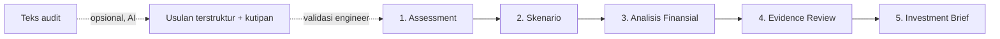

# EnergiAction Bankable

AI-assisted Industrial Energy Investment Readiness untuk sistem kompresor.

EnergiAction Bankable membantu energy manager, auditor energi industri, dan tim utilitas menyusun justifikasi investasi dari temuan audit sistem compressed air. Aplikasi menghitung baseline, membandingkan skenario perbaikan, menghitung simple payback, mencatat status bukti, lalu menghasilkan Investment Decision Brief yang dapat dicetak atau disimpan sebagai PDF.

> Status: demo web untuk pendaftaran MAJU:ON 2026. Semua data contoh adalah simulasi fiktif. Fitur AI belum diaktifkan pada demo. Wawancara pengguna belum dilakukan.

## Status implementasi

| Fitur | Status |
| --- | --- |
| Assessment: input baseline, jam operasi, tarif, biaya per tindakan, sumber pengukuran | Berjalan |
| Validasi input (negatif, > 8.760 jam, persentase di luar 0-100%, NaN/Infinity, salah satuan) | Berjalan |
| Perbandingan 4 skenario dengan perhitungan ulang langsung | Berjalan |
| Skenario gabungan sekuensial (tanpa penghitungan ganda) | Berjalan |
| Analisis finansial dengan panel "Lihat Perhitungan" (rumus, substitusi, sumber) | Berjalan |
| Uji realisasi penghematan 50%, 75%, 100% | Berjalan |
| Estimasi CO₂ hanya jika faktor emisi, wilayah, tahun, dan sumber lengkap | Berjalan, tanpa nilai default |
| Evidence Review dengan status Ready (bukan sertifikasi) | Berjalan |
| Investment Brief: Cetak / Simpan PDF dan salin sebagai teks | Berjalan |
| Penyimpanan isian di browser (localStorage) | Berjalan |
| Endpoint AI ekstraksi teks audit di Cloudflare Worker | Kode tersedia dan diuji dengan stub. Belum aktif. Belum diuji terhadap API model nyata. |
| Akun pengguna, kolaborasi tim, unggah dokumen | Belum ada |
| NPV, IRR, eskalasi tarif, biaya beban kVA | Belum ada |
| URL demo publik | Belum di-deploy dari sesi ini. Lihat bagian Deployment. |

## Alur kerja



AI hanya mengusulkan nama peralatan, masalah, parameter yang tertulis di teks, informasi yang belum tersedia, dan jenis pemeriksaan lanjutan. Semua hasil finansial dihitung oleh kode deterministik setelah input lolos validasi.

## Rumus

| Besaran | Rumus |
| --- | --- |
| Annual Energy (kWh/tahun) | Power (kW) × Operating Hours (jam/tahun) |
| Daya setelah perbaikan | P₀ × (1 − r₁) × (1 − r₂) untuk tindakan yang tumpang tindih |
| Annual Savings (kWh/tahun) | Baseline Energy − Post-improvement Energy |
| Penghematan biaya listrik | Annual Savings × tarif (Rp/kWh) |
| Annual Net Savings | Penghematan biaya listrik − biaya operasional tambahan |
| Simple Payback (tahun) | Investment Cost ÷ Annual Net Savings, hanya jika Net Savings > 0 |
| CO₂ (tCO₂/tahun) | Annual Savings (MWh) × faktor emisi (tCO₂/MWh), hanya jika sumber lengkap |

Implementasi: `src/domain/calculations.js`. Contoh data simulasi A: 110 kW × 6.000 jam = 660.000 kWh/tahun. Gabungan 10% dan 8% menghemat 113.520 kWh/tahun, bukan 118.800 kWh/tahun.

## Aturan validasi input

| Input | Ditolak jika |
| --- | --- |
| Daya (kW) | ≤ 0, negatif, atau > 10.000 kW (indikasi salah satuan W/kWh) |
| Jam operasi | ≤ 0 atau > 8.760 jam/tahun. Mode harian: > 24 jam/hari, > 366 hari, atau hasil kali > 8.760 |
| Tarif | < Rp 100/kWh (indikasi salah pemisah ribuan) atau > Rp 10.000/kWh (indikasi Rp/MWh) |
| Persentase pengurangan daya | < 0% atau > 100% |
| Biaya | Negatif |
| Faktor emisi | ≤ 0 atau > 2 tCO₂/MWh (indikasi gCO₂/kWh) |
| Semua angka | Kosong, huruf, notasi eksponen, NaN, Infinity |

Format angka: `1115`, `1.115`, dan `45.000.000` dibaca sebagai bilangan bulat. `0,5` dan `12.5` dibaca sebagai desimal. Setiap field menampilkan nilai yang terbaca.

Kesalahan pada satu kelompok input hanya memblokir hasil yang bergantung padanya. Contoh: input optimasi kontrol yang tidak valid memblokir S2 dan S3, sedangkan S1 tetap dihitung.

## Arti status Ready

Ready berarti setiap data yang dibutuhkan opsi diusulkan memiliki jenis data, referensi dokumen, tanggal dokumen, dan status "Diperiksa engineer". Baseline daya wajib berasal dari pengukuran. Ready bukan sertifikasi, bukan audit energi oleh auditor bersertifikat, dan bukan verifikasi hasil (M&V).

## Fitur AI (opsional)

| Hal | Implementasi |
| --- | --- |
| Lokasi | `worker/handler.js` (server), `src/ai/extraction-schema.js` (schema dan validator bersama), `src/ai/client.js` (browser) |
| Model | `claude-opus-5-5` melalui `@anthropic-ai/sdk` 0.132.1, structured output JSON schema |
| Kredensial | Secret server `ANTHROPIC_API_KEY`. Kunci tidak pernah dikirim ke browser. |
| Tanpa secret | `/api/ai/status` mengembalikan `enabled: false`. UI menampilkan "AI belum diaktifkan". Input manual tetap berjalan. |
| Penjaga | Schema tanpa field penghematan atau payback. Setiap item wajib memiliki kutipan verbatim. Validator menolak kutipan yang tidak ada di teks dan nilai yang tidak tertulis di kutipan. Nilai masuk formulir hanya setelah engineer klik "Isi ke formulir". |
| Status pengujian | Diuji dengan stub fetch lokal. Belum diuji terhadap API model nyata. |

Mengaktifkan AI pada URL publik membuat setiap pengunjung dapat memicu biaya API. Pasang batas pengeluaran di akun penyedia dan rate limiting di Cloudflare sebelum mengaktifkan.

## Struktur proyek

```text
energipass/
├── index.html                 Kerangka aplikasi, navigasi, dialog panduan
├── styles.css                 Tampilan, responsif, dan aturan cetak (print)
├── src/
│   ├── domain/                Perhitungan, validasi, evidence, brief (tanpa DOM)
│   ├── fixtures/              Data simulasi A dan B (fiktif)
│   ├── ai/                    Schema, validator, dan client AI opsional
│   ├── state/                 Penyimpanan localStorage
│   ├── ui/                    Rendering layar dan view model
│   └── main.js                Routing, event, pembaruan langsung
├── worker/                    Cloudflare Worker: asset statis dan /api/ai/*
├── tests/unit/                Unit test (node:test)
├── tests/e2e/                 End-to-end test (Playwright, Chromium)
├── scripts/                   build, server lokal, perekam video demo
├── docs/                      Validasi masalah, catatan MAJU:ON, skrip video, laporan test, screenshot
└── wrangler.jsonc             Konfigurasi Workers + Static Assets
```

## Menjalankan secara lokal

Prasyarat: Node.js 22 atau lebih baru.

```bash
git clone https://github.com/ghazyachmed/energipass.git
cd energipass
git checkout claude/sweet-newton-rqi1vx
npm ci
npm start
```

Buka http://localhost:4173. Server lokal tidak menyediakan endpoint AI, sehingga UI menampilkan "AI belum diaktifkan".

Untuk menjalankan Worker lengkap (asset + endpoint AI) secara lokal:

```bash
npm run build
npx wrangler@4 dev
```

## Pengujian

```bash
npm test            # unit test: rumus, validasi, skenario, evidence, brief, schema AI, Worker, batas karakter catatan MAJU
npm run test:e2e    # build + end-to-end test di Chromium (desktop dan mobile)
```

`npm run test:e2e` membutuhkan paket `playwright` dan Chromium. Jika belum ada: `npm install --no-save playwright@1.63.0 && npx playwright install chromium`. Hasil terakhir: `docs/TEST_REPORT.md`.

## Deployment (Cloudflare Workers)

Deployment belum dijalankan dari sesi pengembangan ini karena membutuhkan akun Cloudflare. Pilih salah satu jalur.

Jalur A: Workers Builds (Git integration). Atur di Cloudflare dashboard, Settings → Build:

| Pengaturan | Nilai |
| --- | --- |
| Repository | `ghazyachmed/energipass` |
| Branch | `main` setelah branch kerja di-merge, atau branch kerja untuk preview |
| Build command | `npm ci && npm run build` |
| Deploy command | `npx wrangler@4 deploy` |
| Nama Worker | `energipass` (harus sama dengan `name` di `wrangler.jsonc`) |

Jalur B: GitHub Actions. Workflow `.github/workflows/deploy.yml` berjalan saat push ke `main`. Workflow ini membutuhkan secret repository `CLOUDFLARE_API_TOKEN`. Pakai satu jalur saja agar satu push tidak memicu dua deployment.

Jalur C: manual dari komputer sendiri:

```bash
npm ci && npm test && npm run build
npx wrangler@4 login
npx wrangler@4 deploy
```

Setelah deploy, buka URL `https://energipass.<subdomain-akun>.workers.dev` di jendela private browser. Pastikan aplikasi terbuka tanpa login (tidak ada Cloudflare Access pada route tersebut). Pakai URL ini untuk pendaftaran, bukan localhost.

Hosting statis lain juga dapat menyajikan folder `dist/`. Pada hosting statis, fitur AI tidak tersedia.

## Data dan batasan

- Data simulasi A dan B adalah fiktif. Nama fasilitas, referensi dokumen, tarif, dan biaya tidak mewakili perusahaan, pengukuran, penawaran, atau tarif resmi.
- Simple payback tidak memperhitungkan nilai waktu uang, inflasi, pajak, depresiasi, dan umur peralatan.
- Tarif dianggap konstan. Biaya beban kVA dan eskalasi tarif tidak dihitung.
- Persentase pengurangan daya diisi engineer. Pada kompresor load/unload, pengurangan kebocoran tidak menurunkan daya secara proporsional.
- Isian tersimpan hanya di browser pengguna. Tidak ada database server.

## Dokumen pendukung

- `docs/PROBLEM_VALIDATION.md`: klaim dari sumber publik, status verifikasi, dan hipotesis produk yang belum diuji.
- `docs/MAJUON_APPLICATION_NOTES.md`: draf jawaban enam pertanyaan MAJU:ON (maksimal 1.400 karakter per jawaban).
- `docs/DEMO_VIDEO_SCRIPT.md`: storyboard video 90 detik.
- `docs/TEST_REPORT.md`: hasil pengujian aktual.
- `docs/screenshots/`: tangkapan layar desktop dan mobile.

## Riwayat

Versi sebelumnya, EnergiPass (Green Vendor Passport untuk pemeriksaan dokumen tender), tetap tersedia di branch `main` sampai branch kerja ini di-merge. Konsep Evidence Library dan status data dipakai ulang di Evidence Review dengan logika baru untuk data audit energi.

## Pengembang dan lisensi

Dikembangkan oleh [Ghazy Urbayani](https://github.com/GhazyUrbayani). Repository belum menyertakan berkas `LICENSE`.
