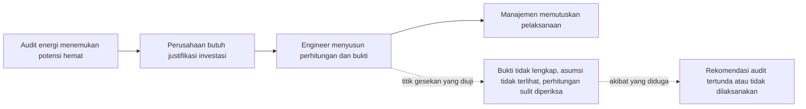

# Validasi Masalah: EnergiAction Bankable

Dokumen ini memisahkan klaim yang didukung sumber publik dari hipotesis manfaat produk. Dokumen ini tidak memuat hasil wawancara pengguna. Wawancara pengguna belum dilakukan.

Status akses sumber: environment pengembangan tidak dapat membuka halaman sumber secara langsung (network policy). Isi sumber di bawah berasal dari cuplikan mesin pencari pada 25 Oktober 2026. Buka dan periksa setiap sumber sebelum mengutip angka di formulir pendaftaran.

## 1. Rantai masalah yang diuji

EnergiAction Bankable menargetkan langkah C. Produk tidak menggantikan audit energi (langkah A) dan tidak memutuskan investasi (langkah D).

## 2. Klaim yang didukung sumber publik

| No | Klaim | Sumber | Status verifikasi | Implikasi untuk produk |
| --- | --- | --- | --- | --- |
| L1 | Pabrik di Amerika Serikat yang menerima audit energi hanya melaksanakan sekitar separuh proyek yang direkomendasikan. Adopsi lebih tinggi untuk payback lebih pendek dan biaya awal lebih rendah. | Anderson dan Newell (2004), Resource and Energy Economics 26(1): 27-50 | Cuplikan abstrak. Angka ambang payback berbeda antara working paper dan versi terbit. | Payback dan biaya awal adalah variabel keputusan utama. Produk menampilkan keduanya secara eksplisit. Data ini berasal dari AS, bukan Indonesia. |
| L2 | Pengalaman ESCO dan konsultan efisiensi energi di Indonesia dalam menyusun Investment Grade Audit (IGA) dan dokumen proyek bankable masih terbatas. Dari 28 IGA untuk Kementerian ESDM periode 2014-2018, hampir tidak ada proyek yang berlanjut. | Energy Transition Partnership, Diagnostic Review and Analysis of Energy Efficiency Development in Indonesia (2024) | Cuplikan mesin pencari. Dokumen asli belum dibuka. | Mendukung adanya celah antara temuan audit dan proyek yang siap dibiayai. Tidak membuktikan bahwa software menutup celah tersebut. |
| L3 | Bank di Indonesia belum menerima proyeksi arus kas penghematan energi sebagai jaminan dan kekurangan data referensi untuk menilai risiko proyek efisiensi energi. | APEC (2017), Energy Efficiency Finance in Indonesia | Cuplikan. Laporan berumur 9 tahun. | Pembiayaan eksternal butuh bukti yang dapat diperiksa. Fokus awal produk tetap pada keputusan internal perusahaan, bukan pinjaman bank. |
| L4 | Bank komersial lokal belum familiar dengan transaksi efisiensi energi. OECD merekomendasikan dukungan penyiapan proyek dan pelatihan IGA. | OECD (2021), Clean Energy Finance and Investment Policy Review of Indonesia | Cuplikan. | Sama dengan L3. |
| L5 | PP 33/2023 tentang Konservasi Energi mewajibkan manajemen energi bagi pengguna energi sektor industri dengan konsumsi ≥ 4.000 TOE per tahun. Kewajiban meliputi manajer energi tersertifikasi, audit energi oleh auditor tersertifikasi, pelaksanaan rekomendasi audit, dan pelaporan. Tahun 2023: 410 entitas melapor, termasuk 217 industri. | Kementerian ESDM, berita "Implementasi Manajemen Energi Tahun 2023 Mampu Hemat 10,42 Juta SBM" | Cuplikan. Satu sumber akademik menyebut ambang 6.000 TOE. Periksa teks PP 33/2023 dan Permen ESDM 8/2025. | Ada kelompok pengguna yang wajib melaksanakan rekomendasi audit. Kelompok ini adalah kandidat pengguna awal. |
| L6 | Penghematan energi sektor industri Indonesia sekitar 2% dari total konsumsi energi. Praktik internasional berada pada 3-5%. | GIZ, berita SETI September 2026 | Cuplikan. | Konteks kesenjangan implementasi. Bukan hasil EnergiAction. |
| L7 | Audit energi SETI (WRI Indonesia) menemukan peluang hemat 58,4 juta kWh per tahun, sekitar Rp44,9 miliar per tahun, dan 50.804 tCO₂ per tahun pada fasilitas yang diaudit. Liputan lain atas program yang sama memuat angka lebih kecil. | WRI Indonesia, artikel wawasan "Energy Efficiency as the Key to Industrial Decarbonization" (versi Indonesia di URL /id/wawasan/) | Cuplikan. Angka antar-sumber tidak konsisten. | Angka ini adalah potensi dari audit pihak lain. Angka ini bukan hasil EnergiAction dan tidak boleh ditampilkan sebagai dampak produk. |
| L8 | Kebocoran pada sistem compressed air yang kurang terawat dapat mencapai 20-30% output kompresor. Program deteksi dan perbaikan dapat menurunkan kebocoran di bawah 10%. Pembangkitan compressed air sekitar 10% listrik fasilitas industri tipikal (data survei DOE lama). | US DOE dan Compressed Air Challenge, Fact Sheet 7 (revisi 2026) | Cuplikan. Data dasar berasal dari studi 1997-2004 di AS. | Mendukung pilihan sistem kompresor sebagai kasus pertama. Persentase pengurangan daya tetap diisi engineer, bukan diambil dari angka ini. |
| L9 | Perangkat lunak audit AIRMaster menghitung tindakan secara interaktif. Setiap tindakan memakai kondisi hasil tindakan sebelumnya untuk mencegah penghematan dihitung berlebih. | ACEEE Summer Study (1997), "AIRMaster: Compressed Air System Audit Software" | Cuplikan. | Dasar metode sekuensial untuk skenario gabungan. |

## 3. Hipotesis produk (belum diuji)

| No | Hipotesis | Cara menguji | Kriteria lulus yang diusulkan |
| --- | --- | --- | --- |
| H1 | Energy manager dan auditor membutuhkan waktu signifikan untuk menyusun ulang perhitungan dan bukti setelah audit, sebelum manajemen memutuskan. | Wawancara 8-12 energy manager atau auditor. Minta contoh proyek terakhir dan urutan kerjanya. | Minimal 5 responden menyebut penyusunan justifikasi sebagai langkah yang berulang atau lama, dengan contoh konkret. |
| H2 | Keputusan tertunda karena asumsi tidak terlihat atau bukti belum lengkap, bukan hanya karena anggaran. | Wawancara yang sama. Tanyakan alasan proyek terakhir yang tertunda. | Minimal 3 responden menyebut bukti, asumsi, atau perhitungan sebagai alasan penundaan. |
| H3 | Register evidence dengan status Pengukuran, Dokumen, Asumsi, dan Belum tersedia membantu engineer menyiapkan brief lebih cepat. | Uji tugas: responden menyusun brief dari data audit contoh dengan dan tanpa demo. | Waktu penyusunan turun dan responden dapat menjelaskan asal setiap angka. Ukur, jangan diasumsikan. |
| H4 | AI yang hanya membaca teks audit menjadi struktur (tanpa menghitung) mengurangi entri ulang data. | Uji setelah AI aktif, dengan teks audit anonim dari responden. | Persentase parameter yang benar dan lolos validasi kutipan. Ukur tingkat penolakan validator. |
| H5 | Perusahaan bersedia membayar untuk alat ini. | Wawancara pembeli (manajer pabrik, keuangan). Jangan menyimpulkan WTP dari pengguna teknis. | Belum ada data. WTP tidak boleh dicantumkan sebelum diuji. |

## 4. Hal yang tidak dibuktikan oleh sumber di atas

- Kewajiban audit energi tidak otomatis membuktikan kebutuhan software.
- Potensi penghematan nasional atau hasil audit pihak lain bukan hasil EnergiAction.
- Sumber L1 berasal dari Amerika Serikat. Perilaku adopsi di Indonesia belum diverifikasi.
- Belum ada data bahwa pengguna Indonesia akan memakai alat berbasis browser untuk tugas ini.

## 5. Panduan wawancara singkat (untuk H1 sampai H3)

1. Ceritakan proyek efisiensi energi terakhir yang diusulkan setelah audit. Apa hasilnya?
2. Siapa yang menyusun justifikasi investasinya? Berapa lama? Alat apa yang dipakai?
3. Data apa yang paling sulit didapat atau paling sering dipertanyakan manajemen?
4. Pernahkah keputusan tertunda karena data atau asumsi? Berikan contoh.
5. Bagaimana manajemen memutuskan: payback, NPV, anggaran tahunan, atau lainnya?
6. Tunjukkan demo. Bagian mana yang tidak sesuai dengan cara kerja Anda?

Catat jawaban apa adanya. Jangan mengarahkan responden ke jawaban yang mendukung produk.

## 6. Daftar sumber

- Anderson, S. T., dan Newell, R. G. (2004). Information programs for technology adoption: the case of energy-efficiency audits. Resource and Energy Economics, 26(1), 27-50. https://ideas.repec.org/a/eee/resene/v26y2004i1p27-50.html
- Energy Transition Partnership (2024). Diagnostic Review and Analysis of Energy Efficiency Development in Indonesia. https://www.energytransitionpartnership.org/wp-content/uploads/2024/04/Diagnostic-Analyses-Report-of-Energy-Efficiency-Development-in-Indonesia.pdf
- APEC (2017). Energy Efficiency Finance in Indonesia: Current State, Barriers and Potential Next Steps. https://apec.org/docs/default-source/Publications/2017/10/Energy-Efficiency-Finance-in-Indonesia-Current-State-Barriers-and-Potential-Next-Steps/217_EWG_APEC_Format_Incubator_EEFMapping_Indonesia_Report.pdf
- OECD (2021). Clean Energy Finance and Investment Policy Review of Indonesia. https://www.oecd.org/en/publications/2021/06/clean-energy-finance-and-investment-policy-review-of-indonesia_966c6193.html
- Kementerian ESDM. Implementasi Manajemen Energi Tahun 2023 Mampu Hemat 10,42 Juta SBM. https://www.esdm.go.id/id/media-center/arsip-berita/implementasi-manajemen-energi-tahun-2023-mampu-hemat-1042-juta-sbm-
- GIZ. Indonesia's Industrial Energy Efficiency Gains Reach Just 2%, Fiscal Incentives Key to Accelerating Progress. https://www.giz.de/en/regions/asia/indonesia/news/indonesias-industrial-energy-efficiency-gains-reach-just-2-fiscal-incentives-key-accelerating
- WRI Indonesia. Energy Efficiency as the Key to Industrial Decarbonization. https://wri-indonesia.org/en/insights/energy-efficiency-key-industrial-decarbonization (versi Indonesia: https://wri-indonesia.org/id/wawasan/efisiensi-energi-kunci-dekarbonisasi-industri)
- WRI Indonesia. Procurement Opportunities. https://wri-indonesia.org/en/about/procurement-opportunities (halaman tidak dapat dibuka dari environment ini. Pencarian tidak menemukan tender aktif yang terkait audit energi industri.)
- US DOE dan Compressed Air Challenge. Fact Sheet 7: Compressed Air System Leaks. https://www.compressedairchallenge.org/data/sites/1/media/library/factsheets2026/fact-sheet-7-compressed-air-system-leaks_updated2026.pdf
- ACEEE (1997). AIRMaster: Compressed Air System Audit Software. https://www.aceee.org/files/proceedings/1997/data/papers/SS97_Panel1_Paper25.pdf
